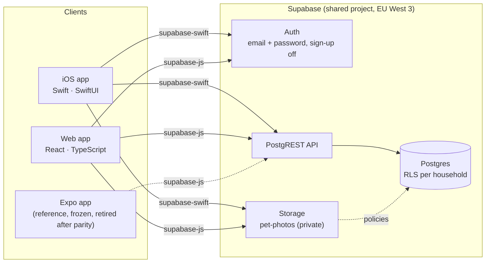
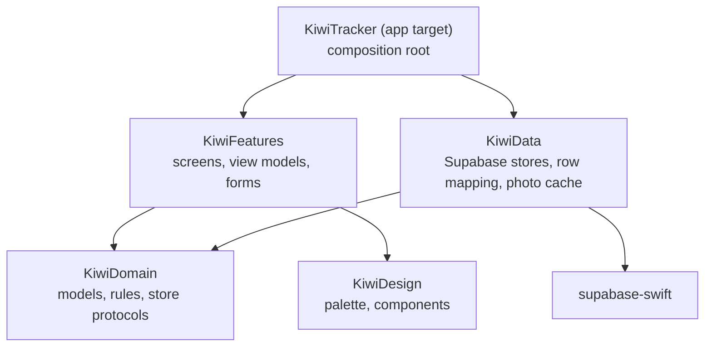
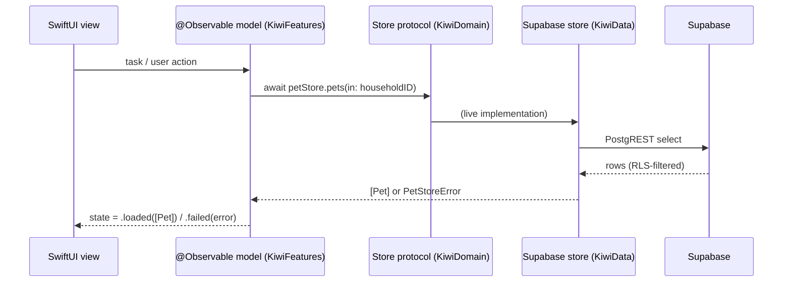

# Architecture

Kiwi Tracker is a pet care and health tracker for a household: log symptoms,
diet changes and other events per pet, plan care in a calendar, and see an
at-a-glance health status across all pets. This repository holds the native
iOS app (Swift, SwiftUI) and, as their work starts, the React web app and the
Supabase backend.

The Expo app ([PatyCu/kiwi-tracker](https://github.com/PatyCu/kiwi-tracker))
is the **reference implementation**: the native iOS app and the React web app
match its capabilities, flows, copy and branding.

## System overview



- **One backend, thin clients.** Every client talks to Supabase directly. There
  is no custom API server: row-level security in Postgres is the authorization
  layer, and `private.is_household_member()` / `private.accessible_pet_ids()`
  stay the single place that decides who sees what.
- **Online-only.** Household data lives in Supabase. Clients keep only the
  session and a cache of pet photos. No offline writes, no sync engine.
- **The schema is the contract.** Migrations are the source of truth; each
  client generates its row types from the schema (`supabase gen types`,
  `--lang swift` and `--lang typescript`) and maps rows to its own domain
  model.
- **Domain rules run on the client.** Health status, current diet, timeline and
  calendar grouping depend on the device's "now" and time zone, so each client
  implements them. The iOS and web suites check them against the same cases
  (see [Keeping clients consistent](#keeping-clients-consistent)).

### Repository layout

```text
kiwi-tracker-swift/
├── AGENTS.md, CLAUDE.md     # agent guidance shared by every part of the repo
├── docs/                    # architecture, backend, design system
├── ios/                     # native iOS app (own AGENTS.md)
├── web/                     # React web app, when its work starts (own AGENTS.md)
└── supabase/                # migrations, seed, local stack config, when moved here
```

`web/` and `supabase/` are added when their work starts; no empty folders
before that.

## iOS app

### Platform and language

| Choice              | Value                                       | Why                                                                                                             |
| ------------------- | ------------------------------------------- | --------------------------------------------------------------------------------------------------------------- |
| Minimum iOS         | 26.0                                        | Current native look (Liquid Glass tab and navigation bars) with no fallbacks; the installed simulator is 26.1. |
| Bundle ID           | `com.patycu.kiwitracker`                    | Fixed once the first TestFlight build exists.                                                                   |
| Devices             | iPhone, portrait                            | Same as the Expo app's iOS build.                                                                               |
| Language            | Swift 6, strict concurrency                 | Data races are compile errors. App and feature code default to `MainActor` isolation.                           |
| UI                  | SwiftUI                                     | UIKit only where SwiftUI has no equivalent, wrapped in one view.                                                |
| State               | Observation (`@Observable`)                 | Native, no third-party state library.                                                                           |
| Async               | `async`/`await`, structured concurrency     | No Combine in new code.                                                                                         |
| Backend SDK         | [supabase-swift](https://github.com/supabase/supabase-swift) | Official SDK for Auth, PostgREST and Storage. The only production dependency.                    |
| Tests               | Swift Testing (+ XCTest for UI tests)       | Bundled with Xcode.                                                                                             |
| Format and lint     | `swift format` (bundled with the toolchain) | No extra tool to install.                                                                                       |
| Project             | Xcode project + one local Swift package     | Xcode's synchronized folders keep the project file small; the package enforces module boundaries.               |

### Modules

The Xcode app target is thin: the `@main` app, the root composition, assets
and Info.plist. Everything else is in a local Swift package, `ios/KiwiKit`,
split into four targets. The compiler enforces the dependency direction, the
way lint did in the Expo app.



| Target         | Holds                                                                                                                                                                   | May import                       |
| -------------- | ----------------------------------------------------------------------------------------------------------------------------------------------------------------------- | -------------------------------- |
| `KiwiDomain`   | Models (`Pet`, `PetEvent`, `CalendarEvent`, `Household`), pure rules (pet status, current diet, timeline entries, month grid, upcoming care), validation, store protocols. | Foundation                       |
| `KiwiData`     | The Supabase client, one store per table or bucket implementing the domain protocols, generated row types and their mapping, the pet photo cache.                       | `KiwiDomain`, Supabase           |
| `KiwiDesign`   | Palette and typography, shared components (load and error state, placeholder card, brand logo, section header).                                                         | SwiftUI                          |
| `KiwiFeatures` | One folder per product area (`Auth`, `Households`, `Today`, `Pets`, `PetEvents`, `PetStatus`, `Calendar`, `CalendarEvents`, `Settings`), each with `UI`, `State`, `Forms`. | `KiwiDomain`, `KiwiDesign`       |

Rules that follow from this:

- Only `KiwiData` imports Supabase. Features never see a row type or the client.
- `KiwiDomain` has no UI and no I/O, so its rules are tested without mocks.
  Time-dependent rules take `now` (and a `Calendar` for the time zone) as input.
- Feature folders mirror the Expo app's `src/modules`, so a capability is found
  in the same place in both. Within `KiwiFeatures`, a folder doesn't reach into
  another's `State` or `Forms`; shared needs move to `KiwiDomain` or
  `KiwiDesign`.
- No `Utils`, `Helpers` or `Common` folders.

### Data flow



- **Stores** (`KiwiData`) are stateless: typed inputs, typed outputs, typed
  errors (`PetStoreError`, …). They map rows to domain models and back.
- **Models** (`KiwiFeatures/*/State`) are `@MainActor @Observable` classes that
  hold what screens show and expose operations: `PetsModel`, `PetEventsModel`,
  `CalendarEventsModel`, `HouseholdModel`, `SessionModel`. They replace the
  Expo app's providers, one for one.
- **Load state** is a single enum, `LoadState<Value>` (`.loading`,
  `.loaded(Value)`, `.failed(Error)`), rendered by one shared view with Retry.
  Retry reloads only what failed, as in the Expo app.
- **Dependency injection** goes through the SwiftUI environment: the app target
  builds the live stores and models once and puts them in the environment.
  Previews and tests use in-memory stores with fixture data
  (`KiwiFeatures/PreviewSupport`, compiled only in Debug).
- **Writes** never drop user input on failure: the form keeps its values and
  shows the error.

### Navigation

| Expo                                | iOS                                                                           |
| ----------------------------------- | ----------------------------------------------------------------------------- |
| Tabs: Today, Pets, Calendar, Settings | `TabView` with `Tab`, SF Symbols matching the Ionicons (house, pawprint, calendar, gearshape). |
| Pets and Calendar stacks            | One `NavigationStack` per tab, with a typed path of `Route` values (`.pet(petID)`, `.petProfile(petID)`, `.record(petID, recordID)`). |
| `ModalSheet` (custom)               | `.sheet` with `presentationDetents`.                                          |
| Confirm dialogs (`dialogs.ts`)      | `.confirmationDialog` / `.alert`.                                             |
| `kiwitracker://` scheme             | Same URL scheme, handled with `onOpenURL` mapped to `Route`.                  |
| Root layout waits for the household | Root view switches on session and household state: sign-in, loading, no household, error with Retry, tabs. |

Routes carry IDs, never objects, so required context stays explicit (pet
operations receive `petID`), as in the Expo app.

### Native components and parity

"Same UX" means the same information architecture, flows, rules, copy,
branding and empty, loading and error states. Platform chrome comes from
native components, so on iOS it looks and behaves like iOS:

| Need                     | Native component                                       |
| ------------------------ | ------------------------------------------------------ |
| Tab bar, navigation bars | `TabView`, `NavigationStack`, toolbars                 |
| Forms in sheets          | `Form`, `TextField`, `Picker`, `Toggle`                |
| Date and time            | `DatePicker`                                           |
| Pet photo                | `PhotosPicker`; scaling to 512px JPEG with ImageIO     |
| Empty states             | `ContentUnavailableView`, styled with the palette      |
| Filter by pet and type   | `Menu` / sheet with toggles                            |
| Password show/hide       | `SecureField` ↔ `TextField` with an eye button         |

Exception: the Calendar's compact month (Monday-first weeks, "‹ Month ›"
header, tapping the selected day deselects it, per-day markers) is a custom
SwiftUI grid built on `Calendar`. `UICalendarView` can't show that header or
deselect a day, so it can't match the reference.

### Branding

- The Expo palette (`src/shared/theme/palette.ts`) becomes color sets in
  `KiwiDesign`'s asset catalog, each with its light and dark value, exposed as
  `Color.kiwi`, `Color.surface`, … The tint is `kiwi`.
- Text uses the system font (SF Pro), as the Expo app does on iOS, with
  Dynamic Type text styles.
- App icon and logo are copied from the Expo app's `assets/images`.
- Appearance (System, Light, Dark) in Settings sets `preferredColorScheme`. As
  in the Expo app, the choice lasts until the app quits.

### Auth, session and photos

- Sign-in with email and password through Supabase Auth; public sign-up stays
  off. supabase-swift keeps the session in the Keychain (the Expo app used
  AsyncStorage) and refreshes tokens while the app is active.
- Pet photos: scaled to 512px JPEG before upload, stored as
  `<pet_id>/<timestamp>.jpg`, shown through signed links valid for one hour
  and re-signed 10 minutes before expiry. Downloaded images are cached in
  Caches under their storage path, so a new link reuses the file; sign-out
  clears the cache. Same behavior as the Expo app on iOS.

### Environments

| Scheme                | Supabase                 | Config                                                                 |
| --------------------- | ------------------------ | ---------------------------------------------------------------------- |
| `KiwiTracker`         | Local stack (`supabase start`) | `ios/Config/Local.xcconfig`, committed (local URL and publishable key). |
| `KiwiTracker Shared`  | Shared project           | `ios/Config/Shared.xcconfig`, git-ignored, same two keys.              |

The xcconfig values reach the app through Info.plist keys read once at launch;
a missing or invalid value fails with an error that names it. Only
publishable keys go in these files. The simulator reaches the local stack at
`127.0.0.1`.

### Testing and validation

| Layer          | What                                                                                                   | How                                        |
| -------------- | ------------------------------------------------------------------------------------------------------ | ------------------------------------------ |
| `KiwiDomain`   | Every rule, ported test-for-test from the Expo app's Jest tests.                                       | Swift Testing, no mocks.                   |
| `KiwiData`     | Row ↔ model mapping and error mapping.                                                                 | Swift Testing with recorded JSON payloads. |
| `KiwiFeatures` | Model state transitions (load, retry, save failure keeps input).                                        | Swift Testing with in-memory stores.       |
| Screens        | Every screen has `#Preview`s for loaded, empty, loading and error, used for visual parity checks.      | Xcode previews.                            |
| App            | The change, end to end, on the local stack in the simulator.                                           | Agent in the simulator panel.              |
| Shared project | The developer's single check before anything is committed.                                             | Developer, `KiwiTracker Shared` scheme.    |

Warnings fail the build (`SWIFT_TREAT_WARNINGS_AS_ERRORS`).

## Backend

The Supabase project, schema, RLS rules, storage layout and seed stay as they
are; the native and web apps are new clients of the same backend.

- **Shared project.** All apps use the Expo app's Supabase project: same
  accounts and data, so the household can switch apps at any time.
- **Ownership.** `supabase/` is copied into this repository, and new
  migrations are written only here. The Expo repo keeps its copy untouched;
  the Expo app is frozen, so it never pushes a migration again.
- **Compatibility.** Parity needs no migrations. Until the Expo app is retired,
  any schema change must keep it working: additive changes only.
- **Local first.** Changes are checked on the local stack, then applied to the
  shared project before the developer's check, as today.

## Web app

When its work starts: React with TypeScript, Vite, React Router and
supabase-js, in `web/`. It talks to the same Supabase project, has its own
`AGENTS.md`, and follows the same parity rule against the Expo app's web build
(including its wide-screen layouts: sidebar navigation and the month grid).

## Keeping clients consistent

The same rules exist in Swift and TypeScript, so they can drift.

- Domain rule tests are ported case-for-case from the Expo app, with the same
  names, so a rule's cases can be compared side by side.
- When the web app starts, those cases move to shared JSON fixtures in this
  repo that both test suites read, so a rule change updates one file and fails
  both suites until both are fixed.
- User-facing copy is matched verbatim to the reference.

## Expo → iOS map

| Expo (`src/…`)                           | iOS (`ios/KiwiKit/Sources/…`)                         |
| ---------------------------------------- | ----------------------------------------------------- |
| `app/` (Expo Router)                     | App target root view, `Route`, tab stacks             |
| `modules/*/model`, pure rule files       | `KiwiDomain`                                          |
| `modules/*/persistence`, `shared/supabase` | `KiwiData`                                          |
| `modules/*/state` (providers)            | `KiwiFeatures/*/State` (`@Observable` models)         |
| `modules/*/forms` (hooks)                | `KiwiFeatures/*/Forms` (`@Observable` form models)    |
| `modules/*/ui`                           | `KiwiFeatures/*/UI`                                   |
| `shared/theme`, `shared/ui`              | `KiwiDesign`                                          |
| `modules/pets/media`                     | `KiwiData` (cache, upload) + `KiwiFeatures/Pets` (picker) |
